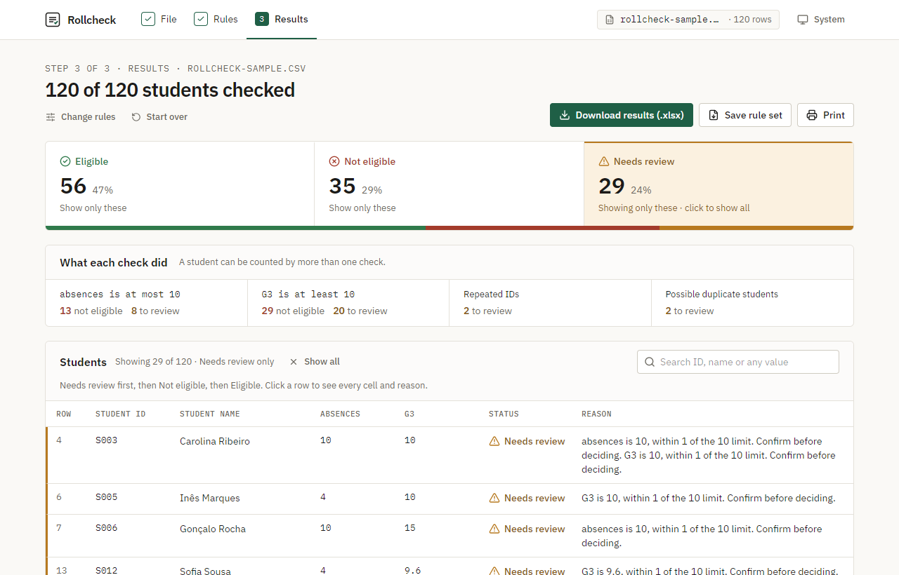
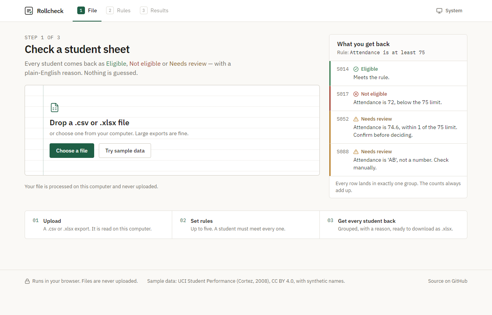
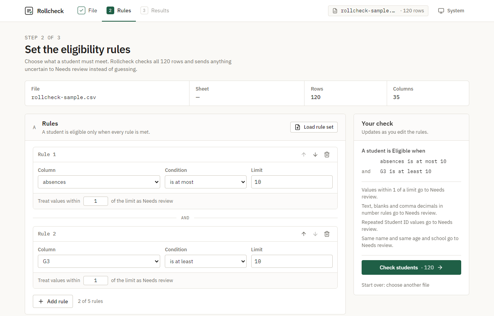
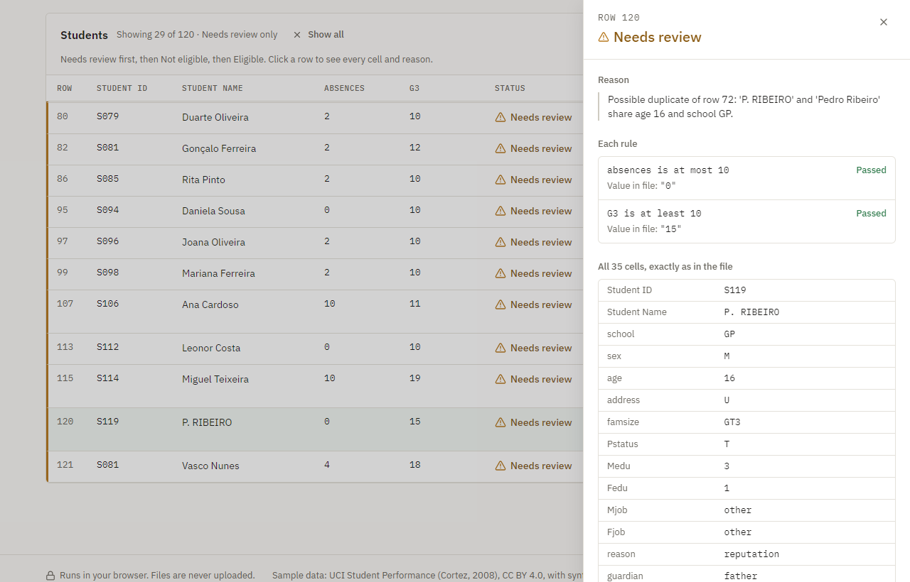

# Rollcheck

[](https://github.com/ankitrajchoudhari/rollcheck/actions/workflows/ci.yml)


[](https://rollcheck-six.vercel.app)
[](LICENSE)

**Check a student spreadsheet against eligibility rules — in the browser, without guessing.**

[Live demo](https://rollcheck-six.vercel.app) · [Planning docs](devpost/) · [Data sources](DATA_SOURCES.md)

Rollcheck sorts every student in an exported sheet into **Eligible**, **Not eligible** or **Needs review**, each with a one-sentence, plain-English reason, and gives you the result back as an Excel file. The file is processed on your computer and never uploaded.



## Who it's for

University office staff — exam cells, scholarship sections, student records — who apply rules like *"attendance at least 75%"* or *"fees cleared"* to exported spreadsheets by hand or with formulas.

Those formulas fail silently, and a wrong result decides whether a real student sits an exam or gets a scholarship:

- a cell **shows 75%** but the real value is **74.6**;
- **"AB"** (absent) is treated as zero, or skipped;
- a **blank** cell slips through;
- **"74,6"** is read as text, or as 746;
- the **same student appears twice** under two spellings.

Rollcheck refuses to guess. Anything a formula would quietly get wrong goes to **Needs review** with the reason, and the counts always add up: *Eligible + Not eligible + Needs review = rows in your file*, or you get an error instead of partial results.

## What it does

1. **Upload** a `.csv` or `.xlsx` file (or click **Try sample data**). Rollcheck finds the header row, detects the delimiter, lets you pick the sheet, guesses the ID and name columns, and shows a typed 5-row preview — values exactly as in the file.
2. **Set 1–5 rules** (or start from a template such as *Exam eligibility* or *Scholarship renewal*), combined with AND: *is at least*, *is at most*, *equals*, *is not*, *is one of*, *is not blank*. Number rules have a margin: *"Treat values within 1 of the limit as Needs review."* A live panel says the rules back in plain English.
3. **See every student** with a reason, Needs review first. Click a counter to filter, search any value, open a row to see every original cell and what each rule decided.
4. **Compare with an Excel formula**: one click shows the `=IF(AND(...))` formula an office would type, what it would decide for every student, and each row where it is silently wrong.
5. **Take it away**: download a 3-sheet `.xlsx` (Results with Status and Reason · Rules used · Needs review), save the rules as a small `.json` for next cycle, or print.

| Reason examples | |
|---|---|
| Not eligible | *G3 is 7, below the 10 limit.* |
| Needs review | *Attendance is 74.6, within 1 of the 75 limit. Confirm before deciding.* |
| Needs review | *absences is 'AB', not a number. Check manually.* |
| Needs review | *G3 is '9,8', which uses a comma. Check whether it means 9.8.* |
| Needs review | *Student ID S081 appears twice (rows 82 and 121).* |
| Needs review | *Possible duplicate of row 72: 'P. RIBEIRO' and 'Pedro Ribeiro' share age 16 and school GP.* |

Duplicates are **flagged, never merged**. Nothing in your data is changed.

| | |
|---|---|
|  |  |
|  | |

## Live demo

**https://rollcheck-six.vercel.app** — click **Try sample data**, then **Check students**. Everything runs in your browser.

## Why not just an Excel formula?

The obvious formula, `=IF(AND(absences<=10, G3>=10), "Eligible", "Not eligible")`, gives a confident answer for every row — including the ones it cannot actually judge. Excel compares text as larger than any number and treats an empty cell as 0, so on the sample sheet:

| Row | Cell | Formula says | What is actually true | Rollcheck |
|---|---|---|---|---|
| 67 | G3 = `9,8` | Eligible | 9.8 is below 10 | Needs review — *uses a comma* |
| 32 | absences blank | Eligible | the value is missing | Needs review — *absences is blank* |
| 44 | absences = `10 ` | Not eligible | 10 meets "at most 10"; only a stray space | Needs review — *number stored as text* |
| 22 | absences = `AB` | Not eligible | nobody checked what AB means | Needs review — *not a number* |
| 72 & 120 | same student, two spellings | Eligible, twice | one student counted twice | Needs review — *possible duplicate* |
| 82 & 121 | one ID used twice | Eligible, twice | two different students share an ID | Needs review — *appears twice* |

A formula also gives no reason, does not prove the counts add up, and must be rewritten correctly by every office for every rule. [`docs/excel-comparison.xlsx`](docs/excel-comparison.xlsx) contains the same 120 students with that formula in a column next to Rollcheck's result, so you can open it in Excel and compare (`npm run compare` rebuilds it).

## Run it locally

Requires [Node.js](https://nodejs.org/) 22 or newer.

```bash
npm install
npm run dev
```

Open http://localhost:5173 and click **Try sample data**, then **Check students**.

| Command | What it does |
|---|---|
| `npm run dev` | Start the app with hot reload |
| `npm test` | Run all tests (engine, export, sample data, UI) |
| `npm run check` | Type-check, lint, test and build — the same gates as CI |
| `npm run demo` | Print the demo-rule counts for the UCI data from the command line |
| `npm run sample` | Rebuild the sample sheet from `data/source/student-mat.csv` |
| `npm run compare` | Rebuild `docs/excel-comparison.xlsx` (formula vs Rollcheck on the sample) |
| `npm run build` | Production build into `dist/` (static files, no server needed) |

## How it works

```
Browser tab (nothing leaves this computer)
├── Screens  src/ui/        File · Rules · Results — display only, no eligibility logic
├── State    src/app/       one reducer
├── Export   src/io/        3-sheet .xlsx, rule-set .json, print
└── Worker   src/worker/    a background thread so 50,000-row files never freeze the page
    └── Engine src/engine/  pure TypeScript, no UI, fully unit-tested
          parse → normalise → evaluate → review → group → invariant
```

The **engine** is the product. Every cell keeps its **raw text** next to the number Rollcheck could — or could not — read from it, and raw text is what you always see:

| Cell | Read as | Decision |
|---|---|---|
| `74.6` | clean number | compared to the limit; within the margin → Needs review |
| `10 `, `75 %`, `12%` | number stored as text | parsed **and** flagged; never decides on its own |
| `74,6` | comma decimal | flagged, **not guessed** |
| `AB`, `N/A` | text | flagged: not a number |
| *(blank)* | blank | flagged (or a failure for *is not blank*) |

A row with any clear failure is **Not eligible**; otherwise any flag makes it **Needs review**; otherwise it is **Eligible**. Every reason is listed. Finally the **invariant** check confirms every row landed in exactly one group with a reason — or the whole result is withheld.

Other details the engine handles: blank rows above the header, blank or repeated column names (renamed and reported), leading-zero IDs and dates kept as displayed, cells Excel shows rounded (the stored value is used), percent-formatted cells, multi-sheet workbooks, and semicolon CSVs that Excel squeezed into a single column.

**Quality, measured:**

| Check | Result |
|---|---|
| Tests (Vitest + React Testing Library) | **153 passing** — every condition, the margin boundary, every edge case, duplicates, rule sets, the invariant, the formula comparison, templates, the exported workbook read back from bytes, every sample trap, the main flow and a keyboard-only run |
| Automated accessibility (axe-core) | **0 violations** on File, Rules, Results and the row detail |
| Lighthouse, live site (desktop / mobile) | Accessibility **100 / 100** · Best practices **100 / 100** · SEO **100 / 100** · Performance **97 / 98** |
| Colour contrast | every text colour checked against WCAG AA in light and dark |
| Large files | 60,000 rows read and checked in a background worker; search in ~0.1 s |
| CI | GitHub Actions runs type-check, lint, tests and build on every push |

**Stack:** Vite, React, TypeScript (strict), Tailwind CSS, [SheetJS](https://docs.sheetjs.com/) (installed from the official SheetJS CDN), [Papa Parse](https://www.papaparse.com/), [TanStack Virtual](https://tanstack.com/virtual), lucide icons, IBM Plex via Fontsource. No backend, no accounts, no API keys.

## Data

The sample data comes from the **UCI Student Performance** dataset — Cortez, P. (2008). *Student Performance* [Dataset]. UCI Machine Learning Repository. https://doi.org/10.24432/C5TG7T — licensed under **[CC BY 4.0](https://creativecommons.org/licenses/by/4.0/)**.

The demo sheet adds a Student ID column, **synthetic names**, and ten deliberately inserted traps (a 9.6 grade, "AB", a blank, a trailing space, "12%", "9,8", a repeated ID and a re-entered student). Every change is listed in **[DATA_SOURCES.md](DATA_SOURCES.md)**. There is no real student data in this repository.

## Limitations

- Rules combine with **AND** only; there is no OR.
- One file at a time — no merging of an attendance export with a fees export.
- Rule sets are saved as `.json` files you keep; nothing is stored in the app.
- Duplicate-name matching is rule-based (same parts or matching initials, plus the columns you choose); it will not catch every possible misspelling.
- The tool flags; it never edits your data. Fix the source sheet and check again.
- `.xls` (old Excel), `.ods` and Google Sheets links are not read — save as `.xlsx` or `.csv`.
- Designed for desktop browsers; it works on a phone but is not built for one.

## Planning documents

Built plan-first. The scope, product requirements and technical spec — each approved before code — are in [`devpost/`](devpost/): [scope.md](devpost/scope.md), [prd.md](devpost/prd.md), [spec.md](devpost/spec.md), plus the build [checklist.md](devpost/checklist.md).

---

Built with the [Devpost Learn Skill Pack](https://github.com/challengepost/learn-ai-basics) using Claude Code.
